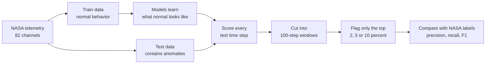
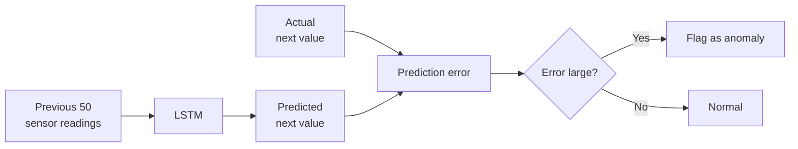
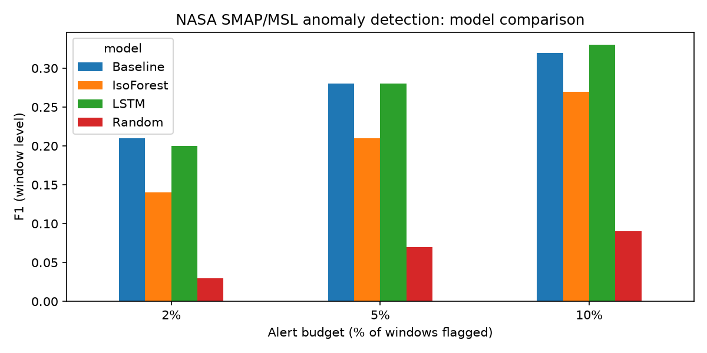

#  Spacecraft Anomaly Detection on NASA SMAP/MSL Telemetry

Teaching a computer to spot when a spacecraft sensor is behaving strangely, using real NASA data, and checking honestly whether the models are actually any good.

## What is this project?
A spacecraft has hundreds of sensors (temperature, voltage, power and more) sending readings every moment. Engineers can't watch them all, so software has to raise a flag when something looks wrong. This project builds and compares three such detectors on real NASA telemetry.

## Why does it matter?
- A problem caught early can be fixed before it damages a mission.
- The same idea powers fraud detection, intrusion detection and predictive maintenance.
- Many anomaly-detection projects report impressive scores that fall apart under a fair test. This one is built around testing fairly.

## The data
- Real telemetry from NASA's **SMAP** satellite and the **Curiosity (MSL)** rover: 82 sensor channels.
- 105 anomalies labeled by NASA JPL experts ([telemanom](https://github.com/khundman/telemanom)).
- `train/` holds normal behavior and `test/` holds data containing anomalies.
- Not included in this repo because of its size. Download it from [Kaggle](https://www.kaggle.com/datasets/patrickfleith/nasa-anomaly-detection-dataset-smap-msl) and place it in `data/train` and `data/test`.

## How it works



## The models
| Model | Idea |
|---|---|
| **Baseline** | Compare each point with its local rolling median. A big gap means anomaly. |
| **Isolation Forest** | Learn normal windows from rolling mean, spread and change. Points that are easy to isolate are anomalies. |
| **LSTM (PyTorch)** | Predict the next value from the previous 50. A big prediction error means anomaly. |
| **Random** | Flags windows by chance. It shows what luck alone scores. |



## How I evaluated (and a mistake I caught)
Each channel is cut into 100-step windows. A window counts as truly anomalous if it overlaps a NASA-labeled anomaly (14.2% of all windows). Every model may flag only a fixed share of windows (2%, 5% or 10%), so they are compared with the same number of alerts.

**What went wrong first:** I started by merging nearby flags and counting any overlap with an anomaly as a catch. Isolation Forest scored F1 = 0.77. But it was flagging about half of all test points, and a **random** flagger scored higher than my real models under the same method. The metric was broken, so I replaced it with the fixed-budget window method above and re-scored everything.

## Results (F1, window level)
| Alert budget | Baseline | Isolation Forest | LSTM | Random |
|---|---|---|---|---|
| 2% | 0.21 | 0.14 | 0.20 | 0.03 |
| 5% | 0.28 | 0.21 | 0.28 | 0.07 |
| 10% | 0.32 | 0.27 | 0.33 | 0.09 |



## Key findings
- All three models beat random by about 3 to 4 times, so they have real signal.
- A simple rolling-median baseline **matches the LSTM**. The extra complexity did not clearly pay off here.
- Isolation Forest is weakest because it sees one window at a time and misses time patterns.
- Always compare against a simple baseline and a random baseline before trusting a score.

## Limitations
- The LSTM was trained for 5 epochs, with one seed and no tuning, so gaps of 0.01 are not meaningful.
- Window size and alert budgets are my own choices. This is not NASA's sequence-level metric, so the numbers can't be compared with the paper.
- Some settings were chosen while looking at the labeled test data, so scores may be slightly optimistic.

## Future work
- Tune the LSTM (longer training, several seeds, different window sizes).
- Use all 25 input columns instead of only the sensor value.
- Add NASA's dynamic thresholding and sequence-level scoring.

## Run it yourself
```bash
pip install numpy pandas matplotlib scikit-learn torch
```
Download the data (see above), then run `anomaly.ipynb` top to bottom.

## Project files
```
nasa_anomaly/
├── anomaly.ipynb          # full pipeline
├── labeled_anomalies.csv  # NASA expert labels
├── results.csv            # results table
├── results.png            # comparison chart
└── README.md
```

**Author:** Divya Bora ([@Codewhizz01](https://github.com/Codewhizz01))